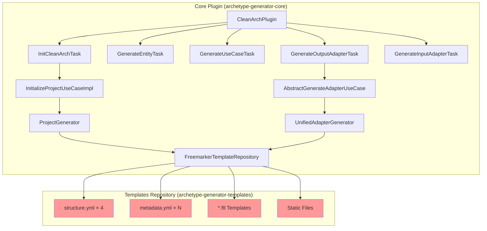
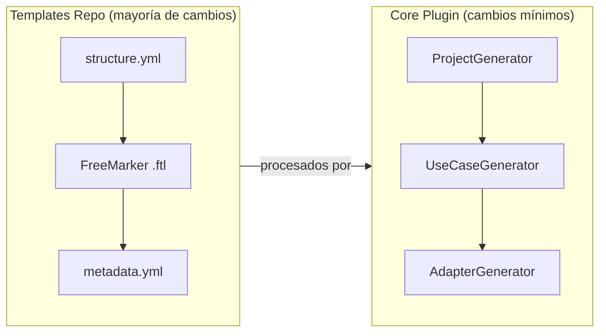
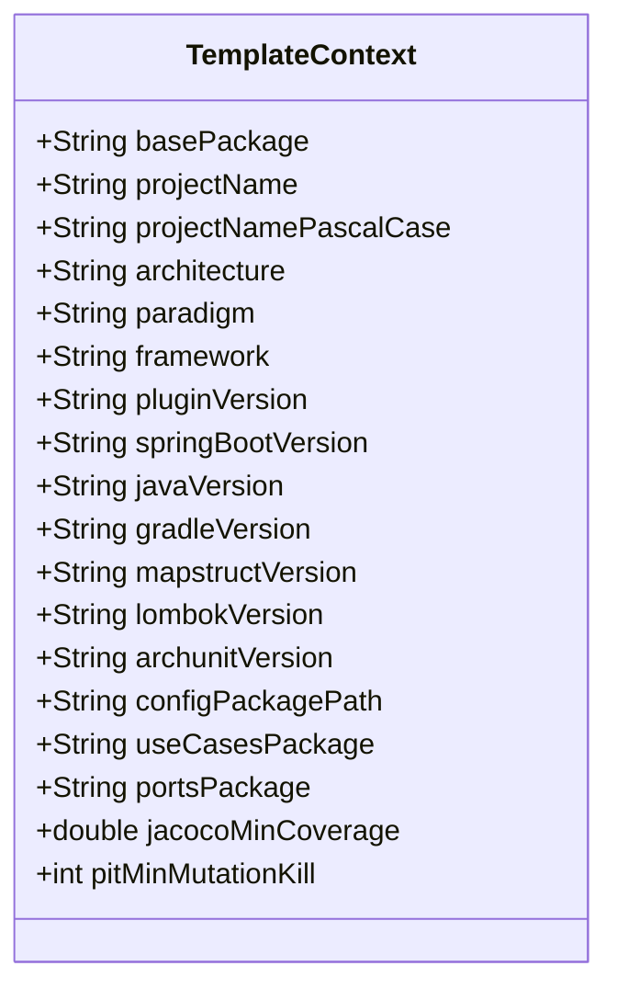

# Design Document: KB Alignment for Hexagonal Architectures

## Overview

Este diseño describe los cambios necesarios en dos repositorios (`archetype-generator-core` y `archetype-generator-templates`) para alinear la salida del generador de arquetipos con los ~70 documentos del Knowledge Base (KB) del Backend Chapter de Pragma. Se abordan 31 gaps identificados que abarcan naming conventions, estructura de paquetes, sistema de build, manejo de errores, paradigma reactivo y quality tooling.

El enfoque es **template-first**: la mayoría de los cambios son en templates FreeMarker (`.ftl`) y archivos de configuración (`structure.yml`, `metadata.yml`). Los cambios en el core plugin son mínimos y se limitan a soportar nuevas variables de contexto y archivos estáticos adicionales.

### Principios de Diseño

1. **Backward compatibility**: Los cambios en el core deben ser aditivos; no romper la API existente del plugin
2. **Template-driven**: Maximizar cambios en templates, minimizar cambios en Java
3. **Convention over configuration**: Las convenciones del KB se aplican por defecto sin configuración adicional
4. **Incremental delivery**: Los cambios se pueden aplicar en sprints independientes

## Architecture

El sistema mantiene su arquitectura hexagonal existente con dos repositorios:



Los nodos en rojo son los archivos que requieren modificación o creación.

### Flujo de Cambios por Capa



## Components and Interfaces

### 1. Cambios en Templates Repository

#### 1.1 Archivos `structure.yml` (4 archivos)

Cada `structure.yml` necesita actualizaciones para reflejar la estructura KB:

| Archivo | Cambios Clave |
|---------|--------------|
| `hexagonal-single/structure.yml` | `port/in` + `port/out` → `ports/` (flat); `application/usecase` → `domain/usecases`; agregar staticFiles para `gradle.properties`, `main.gradle`, `libs.versions.toml`, `lombok.config` |
| `hexagonal-multi/structure.yml` | Mismo cambio de ports flat; mover usecases al módulo domain; agregar staticFiles |
| `hexagonal-multi-granular/structure.yml` | Agregar módulo `helpers`; ports flat; agregar staticFiles |
| `onion-single/structure.yml` | `adapter/in` → `entry-points`; `adapter/out` → `driven-adapters`; agregar staticFiles |

Ejemplo de cambio en `hexagonal-single/structure.yml`:

```yaml
# ANTES
packages:
  - "domain/model"
  - "domain/port/in"
  - "domain/port/out"
  - "application/usecase"

# DESPUÉS
packages:
  - "domain/model"
  - "domain/ports"
  - "domain/usecases"
```

Nuevos `staticFiles` a agregar en los 4 `structure.yml`:

```yaml
staticFiles:
  # ... archivos existentes ...
  
  # Build system files (NUEVOS)
  - source: "project/gradle.properties.ftl"
    destination: "gradle.properties"
    description: "Gradle properties with performance settings"

  - source: "project/main.gradle.ftl"
    destination: "main.gradle"
    description: "Quality tools configuration (JaCoCo, PIT, SonarQube, OWASP, MapStruct)"

  - source: "project/libs.versions.toml.ftl"
    destination: "gradle/libs.versions.toml"
    description: "Centralized dependency version catalog"

  - source: "project/lombok.config.ftl"
    destination: "lombok.config"
    description: "Lombok configuration"

  # Error handling (NUEVOS - condicionales por paradigma)
  - source: "project/UseCasesConfig.java.ftl"
    destination: "{configPackagePath}/UseCasesConfig.java"
    description: "Use case component scan configuration"

  - source: "project/ErrorType.java.ftl"
    destination: "{configPackagePath}/ErrorType.java"
    description: "Standard error type enum"
```

#### 1.2 Nuevos Templates FreeMarker

| Template | Propósito | Ubicación |
|----------|-----------|-----------|
| `UseCasesConfig.java.ftl` | Reemplaza `BeanConfiguration.java.ftl` con regex `@ComponentScan` | `architectures/*/project/` |
| `GlobalExceptionHandler.java.ftl` | RFC 7807 error handling imperativo | `frameworks/spring/imperative/project/` |
| `GlobalErrorWebExceptionHandler.java.ftl` | Error handling reactivo con `AbstractErrorWebExceptionHandler` | `frameworks/spring/reactive/project/` |
| `ErrorType.java.ftl` | Enum de tipos de error estándar | `architectures/*/project/` |
| `Router.java.ftl` | `RouterFunction<ServerResponse>` para REST reactivo | `frameworks/spring/reactive/adapters/entry-points/rest/` |
| `Handler.java.ftl` | Handler class para REST reactivo | `frameworks/spring/reactive/adapters/entry-points/rest/` |
| `RequestParameterValidator.java.ftl` | Validador abstracto para WebFlux | `frameworks/spring/reactive/project/` |
| `gradle.properties.ftl` | Propiedades de Gradle | `architectures/*/project/` |
| `main.gradle.ftl` | JaCoCo, PIT, SonarQube, OWASP, MapStruct | `architectures/*/project/` |
| `libs.versions.toml.ftl` | Version catalog centralizado | `architectures/*/project/` |
| `lombok.config.ftl` | Configuración de Lombok | `architectures/*/project/` |

#### 1.3 Templates Existentes a Modificar

**`Entity.java.ftl`** — Agregar Lombok annotations:
```java
// ANTES
public class ${entityName} {
  private ${idType} id;
  // ... getters/setters manuales

// DESPUÉS
@Data
@Builder
@NoArgsConstructor
@AllArgsConstructor
public class ${entityName} {
  private ${idType} id;
  // Sin getters/setters — Lombok los genera
```

**`InputPort.java.ftl`** — Prefijo `I` y sufijo `UseCase`:
```java
// ANTES
public interface ${useCaseName}UseCase {

// DESPUÉS
public interface I${useCaseName}UseCase {
```

**`UseCase.java.ftl`** — Sufijo `UseCase`, `@RequiredArgsConstructor`, sin `Impl`:
```java
// ANTES
public class ${useCaseName}UseCaseImpl {

// DESPUÉS
@RequiredArgsConstructor
public class ${useCaseName}UseCase implements I${useCaseName}UseCase {
```

**`Controller.java.ftl` (imperativo)** — Agregar OpenAPI annotations, DTOs como Records:
```java
@Tag(name = "${controllerName}", description = "${controllerName} API")
@RestController
@RequestMapping("/api/v1/${controllerName?lower_case}s")
@Validated
public class ${controllerName}Controller {
    @Operation(summary = "Create ${controllerName}")
    @ApiResponse(responseCode = "201", description = "Created")
    @PostMapping
    public ResponseEntity<${controllerName}Response> create(
        @RequestBody @Valid Create${controllerName}Request request) { ... }
```

**`Controller.java.ftl` (reactivo)** — Reemplazar completamente con `Router.java.ftl` + `Handler.java.ftl`:
```java
// Router.java.ftl
@Configuration
public class ${controllerName}Router {
    @Bean
    public RouterFunction<ServerResponse> ${controllerName?uncap_first}Routes(${controllerName}Handler handler) {
        return RouterFunctions.route()
            .path("/api/v1/${controllerName?lower_case}s", builder -> builder
                .GET("", handler::getAll)
                .GET("/{id}", handler::getById)
                .POST("", handler::create)
                .PUT("/{id}", handler::update)
                .DELETE("/{id}", handler::delete))
            .build();
    }
}

// Handler.java.ftl
@Component
@RequiredArgsConstructor
public class ${controllerName}Handler {
    public Mono<ServerResponse> getAll(ServerRequest request) { ... }
    public Mono<ServerResponse> getById(ServerRequest request) { ... }
    public Mono<ServerResponse> create(ServerRequest request) { ... }
}
```

**Todos los `Adapter.java.ftl`** — Implementar `I${entityName}Gateway`, inyectar MapStruct mapper:
```java
// ANTES
@Repository
public class ${adapterName}Adapter implements ${entityName}Repository {

// DESPUÉS
@Repository
@RequiredArgsConstructor
public class ${adapterName}Adapter implements I${entityName}Gateway {
    private final ${entityName}JpaRepository jpaRepository;
    private final ${entityName}EntityMapper mapper;
```

**`http-client/Adapter.java.ftl` (imperativo)** — `RestClient` en lugar de `RestTemplate`:
```java
// ANTES
private final RestTemplate restTemplate;

// DESPUÉS
private final RestClient restClient;

public ${adapterName}HttpClientAdapter(RestClient.Builder restClientBuilder) {
    this.restClient = restClientBuilder.build();
}
```

**`build.gradle.kts.ftl`** — Referenciar version catalog:
```kotlin
// ANTES
id("org.springframework.boot") version "3.2.1"
implementation("org.mapstruct:mapstruct:1.5.5.Final")

// DESPUÉS
alias(libs.plugins.spring.boot)
implementation(libs.mapstruct)
```

**`ArchitectureTest.java.ftl`** — Agregar reglas de naming y eliminar `adapter.in`/`adapter.out`:
```java
// Nuevas reglas
@Test
void portInterfacesShouldHaveIPrefix() {
    classes().that().resideInAPackage("..ports..")
        .and().areInterfaces()
        .should().haveSimpleNameStartingWith("I")
        .check(classes);
}

@Test
void outputPortsShouldHaveGatewaySuffix() {
    classes().that().resideInAPackage("..ports..")
        .and().areInterfaces()
        .and().haveSimpleNameNotStartingWith("I")  // exclude use case ports
        .should().haveSimpleNameEndingWith("Gateway")
        .check(classes);
}
```

**`NamingConventionTest.java.ftl`** — Agregar reglas para `*UseCase`, `*Adapter`, `I*Gateway`.

**Todos los `metadata.yml`** — Actualizar suffix de PostgreSQL:
```yaml
# ANTES (postgresql imperativo)
suffix: "Repository"

# DESPUÉS
suffix: "Adapter"
```

**Reactive REST `metadata.yml`** — Actualizar suffix:
```yaml
# ANTES
suffix: "Controller"

# DESPUÉS
suffix: "Handler"
```

#### 1.4 Cambios en `metadata.yml` de Adaptadores

Todos los `metadata.yml` de driven adapters deben asegurar `suffix: "Adapter"`. El de PostgreSQL imperativo es el único que actualmente tiene `suffix: "Repository"` y debe cambiar.

### 2. Cambios en Core Plugin

#### 2.1 `ProjectGenerator` — Soporte para nuevos static files

El `ProjectGenerator` ya soporta `staticFiles` desde `structure.yml`. Los nuevos archivos (`gradle.properties.ftl`, `main.gradle.ftl`, etc.) se procesan automáticamente al agregarlos a `structure.yml`. No se requieren cambios en Java para esto.

Sin embargo, se necesita agregar variables de contexto para los nuevos templates:

```java
// En ProjectGenerator o InitializeProjectUseCaseImpl
// Nuevas variables para templates de build system
data.put("springBootVersion", "4.0.3");
data.put("javaVersion", "21");
data.put("gradleVersion", "9.0");
data.put("mapstructVersion", "1.6.3");
data.put("lombokVersion", "1.18.36");
data.put("archunitVersion", "1.3.0");
data.put("jacocoMinCoverage", "0.85");
data.put("pitMinMutationKill", "20");
```

#### 2.2 `StructureMetadata` — Soporte para `moduleType` en `structure.yml`

El `StructureMetadata` ya parsea `staticFiles`. Si se agregan campos nuevos como `moduleType`, el parser YAML existente en `StructureMetadataLoader` los ignora silenciosamente (SnakeYAML es tolerante). No se requieren cambios.

#### 2.3 Template Variable Context

Se necesita extender el contexto de variables FreeMarker en `ProjectGenerator` y `UnifiedAdapterGenerator` para incluir:

| Variable | Valor | Usado en |
|----------|-------|----------|
| `springBootVersion` | `"4.0.3"` | `build.gradle.kts.ftl`, `libs.versions.toml.ftl` |
| `javaVersion` | `"21"` | `build.gradle.kts.ftl`, `libs.versions.toml.ftl` |
| `gradleVersion` | `"9.0"` | `gradle-wrapper.properties` |
| `mapstructVersion` | `"1.6.3"` | `libs.versions.toml.ftl`, `main.gradle.ftl` |
| `lombokVersion` | `"1.18.36"` | `libs.versions.toml.ftl` |
| `archunitVersion` | `"1.3.0"` | `libs.versions.toml.ftl` |
| `configPackagePath` | Resuelto dinámicamente | `UseCasesConfig.java.ftl`, error handlers |
| `useCasesPackage` | `"domain.usecases"` | `UseCasesConfig.java.ftl` |

#### 2.4 Reactive REST Metadata — Suffix y Template Discovery

El `metadata.yml` de REST reactivo necesita cambiar su `suffix` de `"Controller"` a `"Handler"` y agregar un template adicional (`Router.java.ftl`). El `TemplateAdapterDiscovery` ya descubre templates automáticamente por directorio, así que agregar `Router.java.ftl` y `Handler.java.ftl` al directorio del adapter es suficiente.

Se necesita un cambio menor: el `UnifiedAdapterGenerator` actualmente genera un solo archivo "main" por adapter. Para REST reactivo, necesita generar dos archivos (Router + Handler). Esto se puede resolver:

- Opción A: Marcar `Router.java.ftl` como template "secondary" y que el generator procese todos los templates descubiertos (no solo el "main")
- Opción B: Agregar `Router.java.ftl` como `additionalResource` en `metadata.yml`

**Decisión**: Opción A es más limpia. Se modifica `UnifiedAdapterGenerator.generateMainFile()` para iterar sobre todos los templates descubiertos (main + secondary) en lugar de solo el main.

#### 2.5 Hexagonal Multi-Granular — Módulo `helpers`

Se agrega el módulo `helpers` a `hexagonal-multi-granular/structure.yml` en la sección `modules`:

```yaml
modules:
  # ... módulos existentes ...
  - name: "helpers"
    path: "infrastructure/helpers"
    description: "Shared cross-cutting utilities"
    packagePath: "infrastructure.helpers"
    dependencies:
      - "model"
      - "ports"
```

El `ProjectGenerator` ya crea módulos listados en `structure.yml`, así que no se requieren cambios en Java.

#### 2.6 Settings.gradle con Flat Module Names

Para multi-module architectures, el `ProjectGenerator.addModuleToSettings()` necesita generar flat module names con `projectDir` mappings:

```groovy
// ANTES
include ':domain:model'

// DESPUÉS
include 'model'
project(':model').projectDir = file('domain/model')
```

Esto requiere un cambio en `ProjectGenerator` para generar el formato correcto.

## Data Models

### Nuevas Variables de Contexto FreeMarker



### Cambios en `AdapterMetadata` Suffix

| Adapter | Paradigma | Suffix Actual | Suffix Nuevo |
|---------|-----------|---------------|--------------|
| PostgreSQL | imperative | `Repository` | `Adapter` |
| PostgreSQL | reactive | (no definido) | `Adapter` |
| REST | reactive | `Controller` | `Handler` |
| Todos los demás | ambos | `Adapter` | `Adapter` (sin cambio) |

### Cambios en Package Paths

| Concepto | Path Actual | Path Nuevo |
|----------|-------------|------------|
| Input ports | `domain/port/in` | `domain/ports` |
| Output ports | `domain/port/out` | `domain/ports` |
| Use cases | `application/usecase` | `domain/usecases` |
| Onion entry-points | `infrastructure/adapter/in` | `infrastructure/entry-points` |
| Onion driven-adapters | `infrastructure/adapter/out` | `infrastructure/driven-adapters` |


## Correctness Properties

*A property is a characteristic or behavior that should hold true across all valid executions of a system — essentially, a formal statement about what the system should do. Properties serve as the bridge between human-readable specifications and machine-verifiable correctness guarantees.*

### Property 1: Flat Domain Ports Package

*For any* valid `ProjectConfig` with any of the four supported architecture types, when the Generator executes `initCleanArch`, the generated project structure SHALL contain a `domain/ports/` package (or module) that is flat — with no `in/` or `out/` sub-packages — and SHALL use the segment `ports` (plural) instead of `port` (singular).

**Validates: Requirements 1.1, 1.2, 1.3, 1.4, 1.5**

### Property 2: Interface I-Prefix on All Ports

*For any* valid use case name or entity name, when the Generator processes the port interface template (`InputPort.java.ftl` or output port template), the generated interface name SHALL start with the prefix `I` (e.g., `I${useCaseName}UseCase`, `I${entityName}Gateway`).

**Validates: Requirements 2.1, 2.2, 2.3, 2.4, 2.5**

### Property 3: Gateway Suffix on Output Ports

*For any* valid entity name and any supported driven adapter type, when the Generator processes the output port template, the generated interface name SHALL end with the suffix `Gateway` (e.g., `IAccountGateway`), and the generated adapter class SHALL implement `I${entityName}Gateway`.

**Validates: Requirements 3.1, 3.2, 3.3, 3.4, 3.5**

### Property 4: DTOs as Java Records

*For any* valid controller name, when the Generator processes the REST entry-point templates, the generated request and response DTOs SHALL be Java Records (using `record` keyword) with suffixes `Request` and `Response` respectively, SHALL NOT use Lombok `@Data`/`@Getter`/`@Setter` annotations, and SHALL NOT use the suffix `DTO`.

**Validates: Requirements 4.1, 4.2, 4.4, 4.5**

### Property 5: Domain Entities with Lombok

*For any* valid entity name and field list, when the Generator processes `Entity.java.ftl`, the generated class SHALL be annotated with `@Data`, `@Builder`, `@NoArgsConstructor`, and `@AllArgsConstructor`, SHALL NOT contain manual getter/setter methods or constructors, and SHALL NOT contain framework annotations (`@Entity`, `@Table`, `@Document`).

**Validates: Requirements 5.1, 5.2, 5.3, 5.4**

### Property 6: MapStruct Mapper Interfaces

*For any* valid entity name and driven adapter type that requires a mapper, when the Generator processes the mapper template, the generated mapper SHALL be an interface annotated with `@Mapper(componentModel = "spring")`, SHALL define `toDomain` and `toEntity` mapping methods, and SHALL NOT contain static mapping methods.

**Validates: Requirements 6.1, 6.2, 6.3, 6.4, 6.5**

### Property 7: UseCasesConfig with Regex Scan

*For any* valid `basePackage`, when the Generator processes `UseCasesConfig.java.ftl`, the generated class SHALL be annotated with `@Configuration` and `@ComponentScan` with a regex filter matching `^.+UseCase$`, SHALL have an empty class body with no `@Bean` methods, and the generated use case classes SHALL NOT contain `@Service` or `@Component` annotations.

**Validates: Requirements 7.1, 7.2, 7.3, 7.4, 7.5**

### Property 8: Reactive REST Uses RouterFunction Pattern

*For any* valid controller name with paradigm `reactive`, when the Generator processes the reactive REST templates, the output SHALL contain a Router class with `RouterFunction<ServerResponse>` and a Handler class with methods accepting `ServerRequest` and returning `Mono<ServerResponse>`, and SHALL NOT contain `@RestController`, `@GetMapping`, `@PostMapping`, `@PutMapping`, `@DeleteMapping`, or `@PatchMapping` annotations.

**Validates: Requirements 8.1, 8.2, 8.3, 8.4, 8.5**

### Property 9: Imperative HTTP Client Uses RestClient

*For any* valid adapter name with paradigm `imperative`, when the Generator processes the HTTP client adapter template, the output SHALL use `RestClient` from Spring 6.1+, SHALL NOT reference `RestTemplate` in any import or field, and SHALL provide methods for GET, POST, PUT, PATCH, and DELETE operations.

**Validates: Requirements 9.1, 9.2, 9.3, 9.4**

### Property 10: Consistent Adapter Suffix

*For any* valid adapter name and any supported driven adapter type, when the Generator generates the adapter class, the class name SHALL end with suffix `Adapter` (never `Repository`). For entry-point adapters, the suffix SHALL be `Controller` for imperative REST and `Handler` for reactive REST.

**Validates: Requirements 12.1, 12.2, 12.3, 12.4**

### Property 11: Use Case Naming Convention

*For any* valid use case name, when the Generator processes `UseCase.java.ftl`, the generated class SHALL be named `${useCaseName}UseCase` (not `${useCaseName}UseCaseImpl`), SHALL be annotated with `@RequiredArgsConstructor`, and SHALL NOT contain `@Service`, `@Component`, or `@Bean` annotations.

**Validates: Requirements 13.1, 13.2, 13.3, 13.4**

### Property 12: Build System Files Generation

*For any* valid `ProjectConfig`, when the Generator executes `initCleanArch`, the output SHALL contain `gradle/libs.versions.toml` with `[versions]`, `[libraries]`, and `[plugins]` sections; `gradle.properties` with Gradle performance settings and credential placeholders; `main.gradle` with JaCoCo (85%), PIT (20%), SonarQube, OWASP, and MapStruct configurations; and `build.gradle.kts` that references dependencies using version catalog aliases (e.g., `libs.mapstruct`) instead of hardcoded version strings.

**Validates: Requirements 14.1, 14.2, 14.3, 15.1, 15.2, 15.3, 15.4, 16.1, 16.2, 16.3, 16.4, 16.5, 16.6, 18.1, 18.2**

### Property 13: Application Configuration Completeness

*For any* valid `ProjectConfig`, when the Generator executes `initCleanArch`, the generated `application.yml` SHALL include `server.shutdown: graceful`, `spring.lifecycle.timeout-per-shutdown-phase: 30s`, Actuator health probes enabled, secrets as `${PLACEHOLDER}` environment variables, and structured logging configuration with JSON format support.

**Validates: Requirements 21.1, 21.2, 21.3, 21.4, 26.1, 26.2, 26.3**

### Property 14: ArchUnit Rules Completeness

*For any* valid `basePackage` and architecture type, when the Generator processes `ArchitectureTest.java.ftl` and `NamingConventionTest.java.ftl`, the output SHALL include rules for: domain layer isolation, application layer isolation, `I` prefix on port interfaces, `*Gateway` suffix on output ports, `*UseCase` suffix on use case classes, `*Adapter` suffix on adapter classes, and SHALL NOT reference `adapter.in` or `adapter.out` package patterns for hexagonal architectures.

**Validates: Requirements 22.1, 22.2, 22.3, 22.4, 22.5, 22.6, 22.7**

### Property 15: Domain Use Cases Package Path

*For any* valid architecture type and use case name, when the Generator executes `generateUseCase`, the generated use case class SHALL be placed in the `domain/usecases/` package (not `application/usecase/`).

**Validates: Requirements 30.1, 30.2, 30.3, 30.4**

### Property 16: Imperative Error Handling with ProblemDetail

*For any* valid `ProjectConfig` with paradigm `imperative`, when the Generator executes `initCleanArch`, the output SHALL contain a `GlobalExceptionHandler` class annotated with `@RestControllerAdvice` that returns `ProblemDetail` objects, and an `ErrorType` enum defining standard error types.

**Validates: Requirements 10.1, 10.2, 10.3, 10.4**

### Property 17: Reactive Error Handling with AbstractErrorWebExceptionHandler

*For any* valid `ProjectConfig` with paradigm `reactive`, when the Generator executes `initCleanArch`, the output SHALL contain a `GlobalErrorWebExceptionHandler` class that extends `AbstractErrorWebExceptionHandler`, overrides `getRoutingFunction`, does NOT use `@RestControllerAdvice`, and an `ErrorType` enum.

**Validates: Requirements 11.1, 11.2, 11.3, 11.4**

### Property 18: OpenAPI Annotations in Imperative Controllers

*For any* valid controller name with paradigm `imperative`, when the Generator processes the REST controller template, the output SHALL include `@Tag` on the class, `@Operation` on each endpoint method, and `@ApiResponse` annotations documenting success and error responses.

**Validates: Requirements 25.1, 25.2, 25.3**

### Property 19: Settings.gradle Flat Module Names

*For any* multi-module architecture (Hexagonal_Multi, Hexagonal_Multi_Granular), when the Generator executes `initCleanArch`, the generated `settings.gradle` SHALL use flat module includes (e.g., `include 'model'`) with `projectDir` mappings (e.g., `project(':model').projectDir = file('domain/model')`).

**Validates: Requirements 19.1, 19.2, 19.3**

### Property 20: Mandatory Static Files Completeness

*For any* valid `ProjectConfig`, when the Generator executes `initCleanArch`, the output SHALL contain at minimum: `Dockerfile`, `gradle.properties`, `gradle/libs.versions.toml`, `main.gradle`, `lombok.config`, `build.gradle.kts`, and architecture test files.

**Validates: Requirements 24.1, 24.4, 24.5**

## Error Handling

### Template Processing Errors

| Error Scenario | Handling Strategy |
|---------------|-------------------|
| Template variable no definida | FreeMarker lanza `TemplateException` → `TemplateProcessingException` con mensaje descriptivo indicando la variable faltante |
| Template `.ftl` no encontrado | `TemplateNotFoundException` con path completo del template buscado |
| `structure.yml` con formato inválido | `StructureMetadataLoader` lanza excepción con línea y columna del error YAML |
| `metadata.yml` con suffix vacío | Validación en `AbstractGenerateAdapterUseCase` (validación 21) rechaza con mensaje claro |
| Combinación adapter-architecture-paradigm no soportada | `IllegalArgumentException` con lista de combinaciones disponibles (Req 28.5) |
| Version catalog alias no encontrado | Build failure con mensaje indicando el alias faltante en `libs.versions.toml` |

### Error Handling en Templates Generados

**Imperativo** (`GlobalExceptionHandler.java.ftl`):
```java
@RestControllerAdvice
public class GlobalExceptionHandler {
    @ExceptionHandler(MethodArgumentNotValidException.class)
    public ProblemDetail handleValidation(MethodArgumentNotValidException ex) {
        ProblemDetail detail = ProblemDetail.forStatus(HttpStatus.BAD_REQUEST);
        detail.setTitle("Validation Error");
        detail.setProperty("errors", extractFieldErrors(ex));
        return detail;
    }
    
    @ExceptionHandler(Exception.class)
    public ProblemDetail handleGeneric(Exception ex) {
        ProblemDetail detail = ProblemDetail.forStatus(HttpStatus.INTERNAL_SERVER_ERROR);
        detail.setTitle("Internal Server Error");
        return detail;
    }
}
```

**Reactivo** (`GlobalErrorWebExceptionHandler.java.ftl`):
```java
public class GlobalErrorWebExceptionHandler extends AbstractErrorWebExceptionHandler {
    @Override
    protected RouterFunction<ServerResponse> getRoutingFunction(ErrorAttributes errorAttributes) {
        return RouterFunctions.route(RequestPredicates.all(), this::renderErrorResponse);
    }
    
    private Mono<ServerResponse> renderErrorResponse(ServerRequest request) {
        Map<String, Object> errorAttributes = getErrorAttributes(request, ErrorAttributeOptions.defaults());
        HttpStatus status = determineHttpStatus(errorAttributes);
        return ServerResponse.status(status)
            .contentType(MediaType.APPLICATION_JSON)
            .bodyValue(errorAttributes);
    }
}
```

## Testing Strategy

### Dual Testing Approach

Este feature es ideal para property-based testing porque:
- Los templates FreeMarker son funciones puras: input (variables de contexto) → output (código Java generado)
- Las propiedades son universales: deben cumplirse para cualquier nombre de entidad, paquete, o use case válido
- El espacio de inputs es grande: nombres de entidades, paquetes, combinaciones de arquitectura/paradigma

### Property-Based Testing

**Library**: [jqwik](https://jqwik.net/) (Java property-based testing framework)

**Configuration**:
- Mínimo 100 iteraciones por property test
- Cada test referencia su property del design document
- Tag format: `Feature: kb-alignment-hexagonal-architectures, Property {number}: {title}`

**Generators necesarios**:
- `validEntityName()`: Genera nombres PascalCase válidos para entidades Java (e.g., `Account`, `TransactionHistory`)
- `validUseCaseName()`: Genera nombres de use case válidos (e.g., `CreateAccount`, `ProcessPayment`)
- `validBasePackage()`: Genera paquetes Java válidos (e.g., `com.pragma.myservice`, `co.com.bank.accounts`)
- `validArchitectureType()`: Genera uno de los 4 tipos de arquitectura
- `validParadigm()`: Genera `reactive` o `imperative`
- `validControllerName()`: Genera nombres de controller válidos

**Estrategia de ejecución**:
- Los property tests procesan templates FreeMarker directamente usando `FreemarkerTemplateRepository`
- Se verifican las propiedades sobre el string de salida (presencia/ausencia de patrones)
- No se requiere compilación del código generado para property tests (eso es integration testing)

### Unit Tests (Example-Based)

| Test | Propósito |
|------|-----------|
| `lombok.config` content | Verificar contenido exacto estático (Req 17) |
| Jakarta Validation en DTOs | Verificar `@NotBlank`, `@NotNull` presentes (Req 4.3) |
| Onion package alignment | Verificar `entry-points`/`driven-adapters` en onion-single (Req 23) |
| Helpers module en multi-granular | Verificar módulo helpers con dependencias correctas (Req 20) |
| HTTP client naming `{system}-client-api` | Verificar naming convention específica (Req 29) |
| RequestParameterValidator en reactive | Verificar generación para paradigma reactivo (Req 27) |

### Integration Tests

| Test | Propósito |
|------|-----------|
| End-to-end: `initCleanArch` → `generateOutputAdapter` → `generateInputAdapter` | Verificar que el proyecto generado compila (Req 31.3) |
| Adapter-architecture-paradigm matrix | Verificar todas las combinaciones soportadas (Req 28) |
| Version catalog integration | Verificar que adapters agregan dependencias al catalog (Req 14.4) |

### Smoke Tests

| Test | Propósito |
|------|-----------|
| `./gradlew build` del plugin después de cambios | Verificar que el plugin compila (Req 31.1) |
| Test suite existente pasa | Verificar backward compatibility (Req 31.2) |
